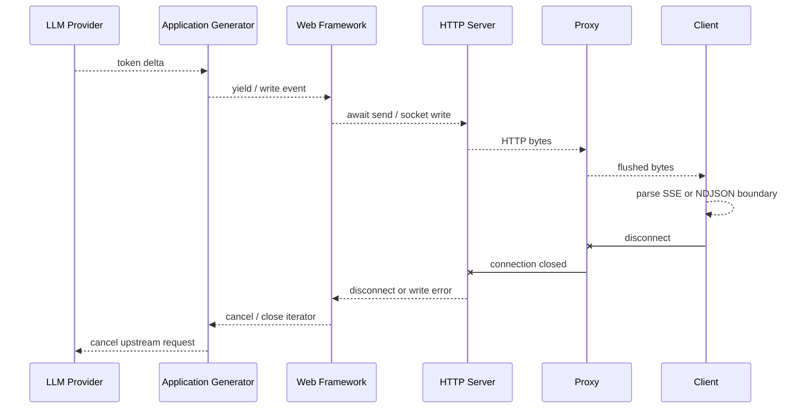

# 003｜流式输出：从协议到前后端实现

> 版本基线：FastAPI 0.141.1、Starlette 1.3.1、Uvicorn 0.52.1、Django 6.0.7、Node.js 24.18.1 LTS。
>
> 核对日期：2026-08-03。文中的源码分析均指向这些固定版本，避免框架升级后实现细节发生漂移。

## 1. 流式输出的协议本质

### 1.1 “流式”不是一次性响应切成几块

真正的 LLM 流式链路要求上游模型产生 token 后，服务端立即向下游写入，而不是先把完整结果存在内存里再分片发送。衡量它的核心指标是首 token 延迟（TTFT）和 token 间延迟，而不只是总耗时。

常见传输方式：

| 方式 | Content-Type | 特点 |
| --- | --- | --- |
| 原始字节流 | `text/plain` 或自定义类型 | 简单，但事件边界和错误语义需自定义 |
| SSE | `text/event-stream` | 单向、自动重连语义清晰，适合浏览器文本生成 |
| NDJSON | `application/x-ndjson` | 每行一个 JSON，适合结构化对象流 |
| WebSocket | 升级连接 | 双向交互强，协议和运维复杂度更高 |

HTTP/1.1 在不知道 `Content-Length` 时通常使用 chunked transfer encoding；HTTP/2 和 HTTP/3 有自己的帧机制。应用层不应手写 HTTP chunk 长度，而应写入业务数据，让服务器和协议栈负责分帧。

还要注意：一次 `yield` 或 `write()` 不等于客户端一次 `read()`。应用数据可能被运行时、内核、TLS、代理或浏览器合并和拆分。因此必须用 SSE 的空行、NDJSON 的换行等应用层边界解析，不能依赖 TCP 包边界。

### 1.2 一条完整的流式调用链



任何一层缓冲都可能让“代码在 yield”变成“用户仍看不到”。反向代理应关闭针对该路由的响应缓冲和压缩聚合，并设置足够长的空闲超时。SSE 可定期发送注释心跳，例如 `: ping\n\n`。

### 1.3 背压与断连

生产级实现必须处理两个反方向的信号：

- **背压**：客户端消费慢，Socket 写缓冲区达到高水位；生产者必须暂停，不能无限积压 token。
- **断连**：浏览器关闭页面或网络中断；服务端应停止生成、释放模型连接并停止计费。

异步框架通常通过 `await send(...)` 传播背压；Node.js 通过 `response.write()` 的布尔返回值和 `drain` 事件传播背压。忽略这些信号会把单个慢客户端变成持续增长的内存队列。

---

## 2. FastAPI 流式输出：实现与源码调用链

### 2.1 可运行的 SSE 示例

```python
import asyncio
import json
from collections.abc import AsyncIterator

from fastapi import FastAPI, Request
from fastapi.responses import StreamingResponse

app = FastAPI()


def encode_sse(event: str, data: dict) -> bytes:
    payload = json.dumps(data, ensure_ascii=False, separators=(",", ":"))
    return f"event: {event}\ndata: {payload}\n\n".encode()


async def fake_llm_stream(question: str) -> AsyncIterator[str]:
    for token in ["问题", "：", question, "。", "回答", "正在", "生成", "。"]:
        await asyncio.sleep(0.15)
        yield token


@app.get("/chat")
async def chat(request: Request, question: str) -> StreamingResponse:
    async def event_stream() -> AsyncIterator[bytes]:
        yield encode_sse("meta", {"version": 1})
        try:
            async for token in fake_llm_stream(question):
                if await request.is_disconnected():
                    return
                yield encode_sse("delta", {"text": token})
            yield encode_sse("done", {"finish_reason": "stop"})
        except asyncio.CancelledError:
            raise
        except Exception:
            yield encode_sse(
                "error",
                {"code": "UPSTREAM_ERROR", "message": "模型服务暂时不可用"},
            )

    return StreamingResponse(
        event_stream(),
        media_type="text/event-stream",
        headers={
            "Cache-Control": "no-cache",
            "X-Accel-Buffering": "no",
        },
    )
```

启动与验证：

```bash
uvicorn app:app --host 127.0.0.1 --port 8000
curl -N 'http://127.0.0.1:8000/chat?question=什么是背压'
```

`curl -N` 关闭 curl 自己的输出缓冲。真实接入模型 SDK 时，`fake_llm_stream()` 应替换为模型提供方的异步流，并在生成器的 `finally` 中关闭或取消上游流。

### 2.2 FastAPI 层做了什么

FastAPI 的路由处理函数最终必须得到一个 Starlette `Response`。在 0.141.1 中，路由层已经能识别生成器端点，并支持原始流、JSONL 和 SSE 的相应分支；手动返回 `StreamingResponse` 时，则走普通 `Response` 快路径，不会先序列化完整 body。

关键边界是：FastAPI 负责依赖注入、路由和返回值选择，真正逐块发送的通用实现位于 Starlette 的 `StreamingResponse`。

调用链可以概括为：

```text
FastAPI path operation
  → fastapi.routing.get_request_handler
  → StreamingResponse(content=async_generator)
  → Starlette StreamingResponse.__call__
  → StreamingResponse.stream_response
  → ASGI send({type: "http.response.body", more_body: true})
  → Uvicorn RequestResponseCycle.send
  → h11.Data
  → asyncio transport.write
```

### 2.3 Starlette `StreamingResponse` 内部实现

可以把普通响应理解成“整道菜做好后一次性端上桌”，而流式响应是“做好一部分就先发送一部分”。`StreamingResponse` 不需要等所有内容生成完毕，而是从生成器中不断取得数据并立即交给 ASGI 服务器。

第一步是判断内容如何产生。如果传入的是异步生成器，Starlette 可以直接使用 `async for` 读取；如果传入的是同步生成器，调用 `next()` 可能阻塞事件循环，因此 Starlette 会用 `iterate_in_threadpool()` 包装它。这里并不是在线程池中一次性生成全部内容，而是每次需要下一块数据时，在线程池里执行一次 `next()`。

接下来，`stream_response()` 按以下顺序发送 ASGI 消息：

1. 先发送一次 `http.response.start`，告诉服务器响应状态码和响应头。
2. 使用 `async for` 从 `body_iterator` 中取得一块数据。
3. 将这一块转换为 bytes，然后发送 `http.response.body`，并设置 `more_body: true`，表示后面还有内容。
4. 重复读取和发送，直到生成器结束。
5. 最后发送一个空 body，并设置 `more_body: false`，告诉服务器响应已经结束。

过程可以简化为：

```text
发送状态码和响应头
  → 生成一块数据
  → 发送一块数据，说明后面还有
  → 继续生成和发送
  → 发送空数据，说明响应结束
```

真正把数据写入网络的是 Uvicorn 等 ASGI 服务器，`StreamingResponse` 的职责是不断产生并提交数据块。

普通响应在发送前已经有完整正文，因此可以提前计算并设置 `Content-Length`。流式响应开始发送时，生成器通常还没有执行完，Starlette 不知道最终会产生多少数据，所以通常不会生成 `Content-Length`。HTTP 服务器会根据协议选择合适的分段方式：HTTP/1.1 通常使用 chunked transfer encoding，HTTP/2 则使用多个 DATA frame。应用层只需要持续提供数据块，不需要自己处理网络分帧。

### 2.4 断连处理为什么与 ASGI 版本有关

流式响应可能持续几秒甚至几分钟。在此期间，用户可能关闭页面、切换路由或者主动取消请求。客户端已经离开后，服务端应尽快停止生成，否则就会出现“用户已经不再接收内容，但上游模型仍在消耗 Token”的情况。

Starlette 1.3.1 会读取 `scope["asgi"]["spec_version"]`，根据 ASGI 版本采用不同的断连处理方式。

在 ASGI 2.4 及以上版本中，处理方式比较直接。Starlette 正在调用 `send()` 发送数据时，如果客户端已经断开，底层服务器会抛出 `OSError`，Starlette 再把它转换为更明确的 `ClientDisconnect`。可以理解成服务端送出下一块数据时，发现接收方已经不在了，于是停止发送。

在更早的 ASGI 版本中，Starlette 不能只依赖 `send()` 发现断连，因此会同时执行两个任务：

```text
任务一：持续生成并发送响应
任务二：持续监听客户端是否断开
```

监听任务通过 `receive()` 等待客户端消息。当收到 `http.disconnect` 时，就取消正在执行的发送任务。也就是说，旧版本需要一边发送内容，一边安排另一个任务专门观察客户端是否仍然在线。

发送任务被取消后，异步生成器通常会收到 `asyncio.CancelledError`。生成器应该在 `finally` 中关闭上游连接、释放资源；如果主动捕获了 `CancelledError`，清理完成后还必须使用 `raise` 继续抛出：

```python
async def generate():
    try:
        async for chunk in model_stream():
            yield chunk
    except asyncio.CancelledError:
        await close_model_stream()
        raise
```

最后的 `raise` 会把“任务已经取消”继续传递给 Starlette、Uvicorn 以及上游调用链。如果吞掉这个异常，生成器可能误以为任务还能继续运行，导致客户端已经断开，上游模型却仍在生成内容。

核心原则是：客户端断开后，不仅要停止向网络发送数据，还要把取消信号继续传递给上游生成任务。

### 2.5 Uvicorn 如何把 ASGI 消息写到网络

以 Uvicorn 的 h11 HTTP/1.1 实现为例，`RequestResponseCycle.send()` 处理两类消息：

- 首个 `http.response.start` 被转换为 `h11.Response`，然后写入 asyncio transport。
- 后续 `http.response.body` 被转换为 `h11.Data`；当 `more_body` 为 false 时，再写入 `h11.EndOfMessage`。

背压发生在发送函数最前面：如果 `flow.write_paused` 为真，就 `await flow.drain()`。`FlowControl` 内部使用一个 `asyncio.Event`；transport 的 `pause_writing()` 清除事件，`resume_writing()` 恢复事件。于是背压沿着以下方向反向传播：

```text
Socket 高水位
  → transport.pause_writing
  → Uvicorn flow.write_paused
  → await flow.drain
  → ASGI send 暂停
  → Starlette async for 暂停
  → LLM token 消费暂停
```

这条链路成立的前提是应用对每次发送都进行 `await`，并且上游 SDK 本身没有在另一个无界队列里抢先缓存完整输出。

### 2.6 FastAPI 常见误区

- 在 `async` 生成器中调用阻塞式模型 SDK，会阻塞整个事件循环；应使用异步 SDK，或把同步迭代器交给线程池路径。
- 响应头一旦发送，就不能把中途异常改成 HTTP 500；应发送 `error` 事件并结束流。
- 不要为流式响应手工设置错误的 `Content-Length`。
- 中间件若读取并重建完整响应体，会破坏流式语义。
- 浏览器跨域、网关超时、代理缓冲和压缩策略都需要单独验证。

---

## 3. Django 流式输出：ASGI、WSGI 与源码差异

### 3.1 ASGI 下的异步 SSE 示例

```python
import asyncio
import json
from collections.abc import AsyncIterator

from django.http import HttpRequest, StreamingHttpResponse


def encode_sse(event: str, data: dict) -> bytes:
    payload = json.dumps(data, ensure_ascii=False, separators=(",", ":"))
    return f"event: {event}\ndata: {payload}\n\n".encode()


async def fake_llm_stream(question: str) -> AsyncIterator[str]:
    for token in ["问题", "：", question, "。", "Django", "正在", "输出", "。"]:
        await asyncio.sleep(0.15)
        yield token


async def chat(request: HttpRequest) -> StreamingHttpResponse:
    question = request.GET.get("question", "")

    async def event_stream() -> AsyncIterator[bytes]:
        yield encode_sse("meta", {"version": 1})
        try:
            async for token in fake_llm_stream(question):
                yield encode_sse("delta", {"text": token})
            yield encode_sse("done", {"finish_reason": "stop"})
        except asyncio.CancelledError:
            raise
        except Exception:
            yield encode_sse(
                "error",
                {"code": "UPSTREAM_ERROR", "message": "模型服务暂时不可用"},
            )

    response = StreamingHttpResponse(
        event_stream(),
        content_type="text/event-stream",
    )
    response["Cache-Control"] = "no-cache"
    response["X-Accel-Buffering"] = "no"
    return response
```

该视图应运行在 ASGI 服务下，并传入异步迭代器。Django 官方文档也强调：长连接和高效流式传输更适合 ASGI；WSGI 下每个长响应会持续占用一个工作进程或线程。

### 3.2 WSGI 下必须匹配同步迭代器

如果部署在 WSGI 服务器，应使用同步生成器：

```python
import json
import time
from collections.abc import Iterator

from django.http import HttpRequest, StreamingHttpResponse


def encode_sse(event: str, data: dict) -> bytes:
    payload = json.dumps(data, ensure_ascii=False, separators=(",", ":"))
    return f"event: {event}\ndata: {payload}\n\n".encode()


def chat_wsgi(request: HttpRequest) -> StreamingHttpResponse:
    question = request.GET.get("question", "")

    def event_stream() -> Iterator[bytes]:
        for token in ["问题", "：", question, "。", "正在", "输出", "。"]:
            time.sleep(0.15)
            yield encode_sse("delta", {"text": token})
        yield encode_sse("done", {"finish_reason": "stop"})

    return StreamingHttpResponse(
        event_stream(),
        content_type="text/event-stream",
        headers={"Cache-Control": "no-cache", "X-Accel-Buffering": "no"},
    )
```

这能流式发送，但它不是高并发异步模型：连接存在多久，工作单元就被占用多久。大量 LLM 长连接通常应优先选择 ASGI。

### 3.3 `StreamingHttpResponse` 如何识别迭代器

Django 6.0.7 的 `_set_streaming_content()` 先尝试 `iter(value)`：

- 成功则保存同步迭代器，并设置 `is_async = False`。
- 抛出 `TypeError` 后再尝试 `aiter(value)`，并设置 `is_async = True`。

它保存的是迭代器而不是原始 iterable，目的是确保内容只被消费一次。`streaming_content` 属性还会对每一块调用 `make_bytes()`，统一转换成字节串。

同步与异步模式不匹配时，Django 会发出警告并进行兼容转换，但转换会破坏真正的流式效果：

- 同步服务器消费异步迭代器时，先通过 `async_to_sync` 把所有块收集到列表。
- 异步服务器消费同步迭代器时，先通过 `sync_to_async(list)` 把所有块收集到列表。

因此必须遵守：**WSGI 对应同步迭代器，ASGI 对应异步迭代器**。这不是单纯的性能优化，而是能否逐块到达客户端的关键。

### 3.4 Django ASGI 发送路径

`ASGIHandler.send_response()` 首先发送 `http.response.start`。对于 `response.streaming`：

1. 通过 `aiter(response)` 消费响应，而不是直接访问 `streaming_content`。
2. 使用 `aclosing()` 保证异步迭代器退出时关闭。
3. 每个生成器产出的 part 再由 `chunk_bytes()` 切成最多 64 KiB 的 ASGI body。
4. 每块发送 `more_body: true`。
5. 迭代完成后发送空的 `http.response.body`；省略的 `more_body` 默认为 false。

64 KiB 的二次切分说明：即使应用一次 yield 了一个很大的字符串，Django 也会把它拆成合理大小的 ASGI 消息。但小 token 是否立即穿过代理，仍取决于下游缓冲策略。

`ASGIHandler.handle()` 同时运行断连监听和请求处理任务。`listen_for_disconnect()` 收到 `http.disconnect` 后触发 `RequestAborted`，处理任务会被取消；`process_request()` 在发送阶段捕获客户端断连导致的 `CancelledError`。应用生成器仍应正确响应取消并清理上游资源。

### 3.5 Django WSGI 发送路径

`WSGIHandler.__call__()` 获取 response 后：

1. 调用 WSGI 的 `start_response(status, headers)`。
2. 直接把 response 返回给 WSGI 服务器。
3. WSGI 服务器迭代 `StreamingHttpResponse.__iter__()` 得到字节块，并负责写入网络。

Django 在这条路径中没有 ASGI 的 `await send()`。具体 Socket 背压、worker 模型和断连行为由 Gunicorn、uWSGI 等 WSGI 服务器及其 worker 类型决定，不能只从 Django 代码推断统一行为。

### 3.6 Django 常见误区

- 在 ASGI 下传同步生成器，虽然“能运行”，Django 可能先整体收集，失去流式效果。
- 在 WSGI 下传异步生成器也会先整体收集，并产生模式不匹配警告。
- 长时间数据库事务不要包住整个流；响应开始后，错误已不能改成新的 HTTP 状态码。
- 某些中间件不适合 streaming response，因为它没有普通 response 的 `.content` 属性。

---

## 4. Node.js 原生 HTTP 流式输出

### 4.1 可运行的 SSE 示例

```javascript
import http from "node:http";
import { setTimeout as delay } from "node:timers/promises";

function encodeSse(event, data) {
  return `event: ${event}\ndata: ${JSON.stringify(data)}\n\n`;
}

function waitForDrain(response) {
  return new Promise((resolve, reject) => {
    const cleanup = () => {
      response.off("drain", onDrain);
      response.off("close", onClose);
    };
    const onDrain = () => {
      cleanup();
      resolve();
    };
    const onClose = () => {
      cleanup();
      reject(new Error("client disconnected"));
    };

    response.once("drain", onDrain);
    response.once("close", onClose);
  });
}

async function writeWithBackpressure(response, chunk) {
  if (!response.write(chunk)) {
    await waitForDrain(response);
  }
}

async function* fakeLlmStream(question, signal) {
  for (const token of ["问题", "：", question, "。", "Node.js", "正在", "输出", "。"]) {
    if (signal.aborted) return;
    await delay(150, undefined, { signal });
    yield token;
  }
}

const server = http.createServer(async (request, response) => {
  const url = new URL(request.url, `http://${request.headers.host}`);

  if (url.pathname !== "/chat") {
    response.writeHead(404).end("Not Found");
    return;
  }

  const abortController = new AbortController();
  response.on("close", () => {
    if (!response.writableEnded) abortController.abort();
  });

  response.writeHead(200, {
    "Content-Type": "text/event-stream; charset=utf-8",
    "Cache-Control": "no-cache",
    "X-Accel-Buffering": "no",
  });

  try {
    await writeWithBackpressure(response, encodeSse("meta", { version: 1 }));
    const question = url.searchParams.get("question") ?? "";

    for await (const token of fakeLlmStream(question, abortController.signal)) {
      await writeWithBackpressure(response, encodeSse("delta", { text: token }));
    }

    if (!abortController.signal.aborted) {
      await writeWithBackpressure(
        response,
        encodeSse("done", { finish_reason: "stop" }),
      );
    }
  } catch (error) {
    if (!abortController.signal.aborted && !response.destroyed) {
      response.write(
        encodeSse("error", {
          code: "UPSTREAM_ERROR",
          message: "模型服务暂时不可用",
        }),
      );
    }
  } finally {
    if (!response.writableEnded && !response.destroyed) response.end();
  }
});

server.listen(8000, "127.0.0.1");
```

启动与验证：

```bash
node server.mjs
curl -N 'http://127.0.0.1:8000/chat?question=什么是背压'
```

### 4.2 `response.write()` 之后发生了什么

`ServerResponse` 最终继承 Node.js 核心的 `OutgoingMessage`。在 Node.js 24.18.1 中，关键路径是：

```text
response.write(chunk)
  → OutgoingMessage.write
  → write_(message, chunk, ...)
  → 隐式生成响应头
  → 按需添加 HTTP/1.1 chunk framing
  → message._send
  → message._writeRaw
  → socket.write
```

第一次 `write()` 前如果还没有响应头，`write_()` 会调用 `_implicitHeader()`。`_storeHeader()` 根据 `Content-Length`、`Transfer-Encoding`、是否有 body 和 keep-alive 等状态决定分帧方式：没有长度且允许默认 chunked encoding 时，会添加 `Transfer-Encoding: chunked`。

当 `chunkedEncoding` 为真时，`write_()` 向底层发送的不是只有业务 chunk，而是：

```text
<十六进制长度>\r\n
<业务数据>\r\n
```

`response.end()` 最终发送 `0\r\n`、可选 trailer 和最后一个 `\r\n`，结束 HTTP/1.1 chunked body。应用代码不应自己拼这些帧；SSE 的 `\n\n` 是应用事件边界，和 HTTP chunk framing 是两层不同协议。

### 4.3 Node.js 背压实现

`OutgoingMessage.write()` 返回 `write_()` 的结果。如果结果为 false，它设置内部 `kNeedDrain`。返回 false 的常见原因是：

- 当前消息还没有绑定可写 Socket，自身排队数据超过 `kHighWaterMark`。
- 已绑定 Socket，但 `socket.write()` 的内部可写缓冲达到高水位。
- chunked cork 缓冲累计超过消息的高水位。

底层数据排空后，Node.js 才会触发 response 的 `drain`。示例中的 `writeWithBackpressure()` 在 false 时等待 `drain`，从而暂停 `for await`，把压力继续传回 LLM 流。

如果完全忽略 `write()` 的返回值，Node 不会自动停止业务生成器；它会继续排队数据，慢客户端可能导致内存持续增长。

### 4.4 断连与错误

`ServerResponse` 的 `close` 表示响应完成或底层连接提前关闭。示例只在 `writableEnded` 为 false 时中止 `AbortController`，再把 signal 传给上游生成器。真实 SDK 若支持取消，也应使用同一个 signal 或在 close 回调中调用 SDK 的取消方法。

与 Python 框架相同，`writeHead(200)` 或首次 `write()` 后，HTTP 状态和响应头已经发送。后续错误只能通过 SSE `error` 事件、直接关闭连接或让客户端查询最终状态来表达。

---

## 5. FastAPI、Django、Node.js 对比

| 维度 | FastAPI | Django | Node.js 原生 HTTP |
| --- | --- | --- | --- |
| 编程模型 | ASGI-first，`async` 生成器自然 | 同时支持 ASGI/WSGI，必须匹配迭代器模式 | 事件循环 + Stream，`write/end` |
| 应用接口 | `StreamingResponse` 或生成器响应 | `StreamingHttpResponse` | `ServerResponse.write()` |
| 同步源处理 | Starlette 在线程池逐次迭代 | ASGI 下同步源会被整体收集，不适合真流式 | 同步计算会直接阻塞事件循环 |
| 异步源处理 | 直接 `async for` | ASGI 直接 `async for`；WSGI 下会整体收集 | `for await...of` |
| 框架到服务器 | ASGI `http.response.*` 消息 | ASGI 消息，或把 iterable 返回给 WSGI server | 直接进入 Node 核心 HTTP/Socket 层 |
| 背压 | `await send`，Uvicorn 在 transport 暂停时 `drain` | ASGI 下由 `await send` 和 ASGI server 传播；WSGI 取决于服务器 | `write() === false` 后等待 `drain` |
| 断连 | ASGI 2.4 写异常，旧规范监听 `http.disconnect` | ASGI 并行监听 `http.disconnect` 并取消任务 | `close` 事件、destroyed 状态、AbortSignal |
| HTTP/1.1 分块 | Uvicorn/h11 处理 | ASGI/WSGI server 处理 | 核心 `_http_outgoing` 处理 chunk framing |
| 大块二次切分 | 普通流按应用 chunk；文件响应单独分块 | ASGI handler 将 part 切为最多 64 KiB | Socket 和内部 writable buffer 负责缓冲 |
| 长连接资源模型 | 异步，适合大量 I/O 型连接 | ASGI 合适；WSGI 长连接占用 worker | 单线程事件循环适合 I/O，但 CPU 工作需隔离 |
| 主要风险 | 阻塞 SDK、代理缓冲、取消未向上传播 | ASGI/WSGI 模式错配导致整体收集 | 忽略 `write()` 返回值导致内存积压 |

选择建议：

- 新建 Python LLM 网关、依赖异步 SDK：优先 FastAPI/ASGI。
- 已有 Django 业务系统：继续使用 Django，但为长流部署 ASGI，并确保异步迭代器贯穿上游。
- 团队熟悉 JavaScript、需要少量抽象和直接控制 Stream：Node.js 原生 HTTP 或其上层轻量框架都合适，但必须显式处理背压。
- 已有 WSGI 系统且并发很低：同步 `StreamingHttpResponse` 可以工作；连接规模增长前应压测 worker 占用。

---

## 6. 前端如何接收流式传输

服务端持续写出数据后，前端还需要选择合适的浏览器 API、正确解析应用层边界，并控制渲染频率。常见方案不是简单的“谁更快”，而是在请求能力、协议复杂度、双向通信和运行成本之间取舍。

### 6.1 四种常见接收方式

| 方式 | 典型协议 | 请求能力 | 优点 | 局限 | 适用场景 |
| --- | --- | --- | --- | --- | --- |
| `EventSource` | SSE | 主要是 GET，不能自定义普通请求头 | 浏览器原生解析事件，自动重连，代码最少 | POST、请求体和自定义鉴权头不方便；需处理重复事件 | 通知、日志、简单问答流 |
| `fetch()` + `ReadableStream` | SSE 或自定义文本帧 | 支持 POST、请求体、自定义头和 `AbortSignal` | 灵活，适合现有聊天接口，可主动取消 | 需要自己处理分块、事件边界、重连和错误 | LLM 聊天与生成接口的通用首选 |
| `fetch()` + `ReadableStream` | NDJSON | 与普通 fetch 相同 | 每行都是完整 JSON，逐条校验简单，结构化语义清晰 | JSON 解析次数更多；换行必须严格转义和分帧 | 工具事件、检索结果、批量对象流 |
| `WebSocket` | WebSocket 帧 | 长连接双向通信 | 双向、低帧开销，服务端可随时主动推送 | 重连、心跳、鉴权、扩缩容和背压协议都要自行设计 | 实时语音、协同编辑、频繁双向控制 |

`EventSource` 最适合标准 SSE。浏览器会自动识别 `event`、`data`、`id` 和 `retry` 字段：

```javascript
const source = new EventSource(`/chat?question=${encodeURIComponent(question)}`);

source.addEventListener("delta", (event) => {
  const { text } = JSON.parse(event.data);
  appendToBuffer(text);
});

source.addEventListener("done", () => {
  source.close();
  flushFinalResult();
});

source.addEventListener("error", () => {
  source.close();
  showConnectionError();
});
```

示例在错误时主动关闭连接，是因为一次性生成任务通常不能直接续传。若要使用 `EventSource` 的自动重连，应让服务端发送事件 ID，并用 `Last-Event-ID` 恢复和去重，否则可能重复展示已经收到的文本。

LLM 聊天通常需要 POST JSON、认证头和主动取消，因此更常用 `fetch()` 读取 `response.body`。下面的示例保留跨网络 chunk 的残片，再按 SSE 空行边界解析；不能假设一次 `reader.read()` 恰好得到一个事件。

```javascript
async function streamChat(messages, signal, onEvent) {
  const response = await fetch("/chat", {
    method: "POST",
    headers: {
      Accept: "text/event-stream",
      "Content-Type": "application/json",
    },
    body: JSON.stringify({ messages }),
    signal,
  });

  if (!response.ok || !response.body) {
    throw new Error(`HTTP ${response.status}`);
  }

  const reader = response.body.getReader();
  const decoder = new TextDecoder();
  let buffer = "";

  while (true) {
    const { value, done } = await reader.read();
    buffer += decoder.decode(value, { stream: !done });

    const blocks = buffer.split(/\r?\n\r?\n/);
    buffer = blocks.pop() ?? "";

    for (const block of blocks) {
      let event = "message";
      const data = [];

      for (const line of block.split(/\r?\n/)) {
        if (line.startsWith("event:")) event = line.slice(6).trim();
        if (line.startsWith("data:")) data.push(line.slice(5).trimStart());
      }

      if (data.length > 0) onEvent(event, JSON.parse(data.join("\n")));
    }

    if (done) break;
  }
}

const controller = new AbortController();

await streamChat(messages, controller.signal, (event, data) => {
  if (event === "delta") appendToBuffer(data.text);
  if (event === "done") flushFinalResult();
});

// 用户点击“停止生成”时调用：
// controller.abort();
```

如果服务端发送 NDJSON，读取循环相同，但分隔符改为单个换行，每一行都执行一次 `JSON.parse()`。生产实现还应限制单个事件大小、处理非法 JSON，并验证 `Content-Type`，避免错误页被当作事件流解析。

### 6.2 性能与效率怎么比较

| 维度 | EventSource | Fetch 流 | NDJSON 流 | WebSocket |
| --- | --- | --- | --- | --- |
| 首包与吞吐 | 与普通 HTTP 流接近 | 与 EventSource 接近 | 与 Fetch SSE 接近 | 建连后帧开销最低 |
| 应用层开销 | 少量 SSE 文本字段 | 取决于 SSE 或自定义格式 | 每条记录一次 JSON 解析 | 二进制或文本帧，包头较小 |
| 前端 CPU | 原生解析，通常最低 | 手动解码与分帧，开销通常很小 | 高频小对象会增加解析和 GC | 取决于自定义协议与消息频率 |
| 内存风险 | 主要来自渲染队列 | 残片和未渲染文本可能积压 | 大行或对象队列可能积压 | 未处理消息队列可能积压 |
| 连接管理 | 自动重连，但需事件 ID 去重 | 取消简单，重连需自行实现 | 同 Fetch | 双向灵活，但恢复协议最复杂 |
| 基础设施 | 复用 HTTP、代理支持成熟 | 复用 HTTP、兼容现有 API | 复用 HTTP | 需要网关支持升级和长连接治理 |

对 LLM 文本生成而言，模型首 token 延迟通常远大于浏览器解析 SSE 与 NDJSON 的差异。真正容易拖慢体验的是代理缓冲、服务端过度攒批、前端每个 token 触发一次框架更新，以及每次增量都重新解析整篇 Markdown。

因此，单向聊天优先选择 SSE：请求简单时用 `EventSource`，需要 POST、鉴权头或主动取消时用 Fetch 流。只有业务本身需要持续双向低延迟消息时，WebSocket 的额外复杂度才通常值得。

### 6.3 前端与链路优化空间

- **增量解码**：复用一个 `TextDecoder` 并使用流式模式，避免 UTF-8 多字节字符跨 chunk 时出现乱码。
- **批量渲染**：先把 token 追加到内存缓冲，每个 `requestAnimationFrame` 或每 30～60 ms 更新一次 UI，避免每个 token 都触发组件重渲染。
- **降低 Markdown 重算**：生成中节流解析，或只渲染新增的稳定块；收到 `done` 后再做一次完整解析与代码高亮。
- **适度合并服务端增量**：首 token 立即发送，之后按 20～50 ms 或小字符阈值合并，减少事件数、JSON 解析和 DOM 更新，同时保持打字感。
- **有界缓冲**：限制单个事件和待渲染队列大小。前端消费明显落后时应暂停复杂渲染，而不是无限保存中间视图状态；正文 token 不能静默丢弃。
- **及时取消**：页面卸载、用户停止生成或新请求替换旧请求时调用 `AbortController.abort()`，并确保服务端继续把取消传播到模型提供方。
- **避免重复内容**：事件携带递增 `id` 或 `seq`；断线恢复后按序号去重，并明确区分可续传与必须重新生成的请求。
- **控制连接数量**：HTTP/1.1 下同源 SSE 连接数较受限；优先复用 HTTP/2 或 HTTP/3，并避免为同一页面的每个组件单独建立长连接。
- **核对压缩与代理**：压缩器和代理可能为了凑块而缓冲小事件。不要凭经验一律开关压缩，应分别测量直连与生产链路的首 token 延迟。
- **观测用户侧指标**：同时记录请求发出、响应头到达、首事件解析、首次渲染、`done` 到达和取消生效时间，才能区分模型慢、网络慢还是渲染慢。

一个实用的渲染策略是“网络层尽快读，视图层定时批量刷”：读取循环持续解析并写入字符串缓冲，UI 每帧最多更新一次。这样既能及时发现 `error` 和 `done`，也能避免高频状态更新占满主线程。

### 6.4 选型建议

对于当前 Web LLM 应用，默认选择应是 **`fetch + ReadableStream + SSE`**。它同时满足聊天接口常见的 POST JSON、鉴权头、流式文本、Agent 事件和“停止生成”需求，又能继续使用成熟的 HTTP 网关与监控体系。

```text
Web LLM 应用
├─ 文本聊天、内容生成、RAG 问答
│  └─ fetch + ReadableStream + SSE（默认）
├─ 已先创建任务，前端只需用 task_id 订阅结果
│  └─ EventSource + SSE
├─ 连续返回可独立校验的结构化对象
│  └─ fetch + ReadableStream + NDJSON
└─ 实时语音或多模态，需要持续上传数据并同时接收模型事件
   └─ WebSocket，并补齐重连、心跳、序号、鉴权和背压协议
```

Agent 的思考状态、工具调用、引用来源和文本增量仍属于服务端单向事件流，用 SSE 的不同事件类型即可，不需要仅因为“事件种类多”就升级为 WebSocket。`EventSource` 更适合先通过普通请求创建生成任务，再用不含敏感提示词的 `task_id` 发起 GET 订阅；不建议把完整提示词放进 URL。

---

## 7. 生产级设计清单

### 7.1 输入与提示词

- 使用任务、上下文、输出契约三段式。
- 给外部数据加边界，声明数据不是指令。
- 记录模板版本、模型版本和实际输入摘要。
- 对上下文做检索和裁剪，为输出保留 token 预算。
- 对高风险工具调用做权限校验和人工确认。

### 7.2 结构化输出

- 优先使用提供方支持的 Schema 约束，而不只依赖“返回 JSON”的提示词。
- 服务端再次校验类型、枚举、长度和业务规则。
- 对未知信息允许 `null`，禁止模型编造默认值。
- 校验失败只做有限修复重试，并保留可观察的失败原因。
- 不要把半截 JSON 当作完整对象解析；流式对象使用 NDJSON、事件或 Patch。

### 7.3 流式传输

- SSE 响应使用 `text/event-stream`，每个事件以空行结束。
- 发送 `meta`、`delta`、`done`、`error` 等有类型事件。
- 定义递增序号或事件 ID，便于客户端去重和诊断。
- 正确处理背压，禁止无界队列。
- 客户端断开时取消上游模型请求。
- 禁用目标路由的代理缓冲，并核对压缩与超时策略。
- 用心跳维持空闲连接，但不要用高频心跳制造额外负载。
- 不在流中泄露内部异常、密钥、完整提示词或敏感上下文。

### 7.4 错误语义

流开始前的鉴权、参数和配额错误应使用正常 HTTP 状态码。流开始后的错误不能再改状态码，推荐发送：

```text
event: error
data: {"code":"RATE_LIMITED","message":"请求过于频繁","retryable":true}

```

随后正常结束流或关闭连接。客户端只有收到 `done` 才把请求视为完整成功；只有连接关闭但没有 `done` 时，应标记为不完整结果。

---

## 8. 如何验证“真的在流式输出”

### 8.1 命令行验证

```bash
curl -N -D - 'http://127.0.0.1:8000/chat?question=stream-test'
```

检查：

1. 响应头及时出现。
2. `delta` 随时间逐步出现，而不是结束时一次性出现。
3. 每个 SSE 事件有空行分隔。
4. 正常结束时一定有 `done`。
5. 中途按 `Ctrl+C` 后，服务端上游生成任务很快停止。

### 8.2 慢客户端验证背压

测试环境可用一个故意慢读的客户端，观察服务端内存是否稳定、生成速度是否随下游暂停。不要只在 localhost 上用浏览器目测，因为本地网络很快，难以触发高水位。

### 8.3 经过真实代理验证

至少分别测试：直连应用服务、经过开发网关、经过生产 CDN/Ingress。若直连逐字出现、经过代理却一次性出现，优先检查响应缓冲、压缩、缓存和超时，而不是修改生成器里的 `sleep()`。

### 8.4 建议观测指标

- 请求总数、并发流数量、异常结束率。
- 首 token 延迟、token 间延迟、总生成时长。
- 输入/输出 token、模型结束原因。
- 客户端断连数、上游取消成功率。
- 每连接待发送字节、背压等待时间。
- 流开始后错误事件数量和缺少 `done` 的连接数。

---

## 9. 源码与规范参考

以下链接固定到文中分析的版本：

- [FastAPI 0.141.1 路由返回值与流式分支](https://github.com/fastapi/fastapi/blob/0.141.1/fastapi/routing.py)
- [Starlette 1.3.1 `StreamingResponse`](https://github.com/encode/starlette/blob/1.3.1/starlette/responses.py)
- [Uvicorn 0.52.1 h11 `RequestResponseCycle.send`](https://github.com/encode/uvicorn/blob/0.52.1/uvicorn/protocols/http/h11_impl.py)
- [Uvicorn 0.52.1 `FlowControl`](https://github.com/encode/uvicorn/blob/0.52.1/uvicorn/protocols/http/flow_control.py)
- [Django 6.0.7 `StreamingHttpResponse`](https://github.com/django/django/blob/6.0.7/django/http/response.py)
- [Django 6.0.7 `ASGIHandler`](https://github.com/django/django/blob/6.0.7/django/core/handlers/asgi.py)
- [Django 6.0.7 `WSGIHandler`](https://github.com/django/django/blob/6.0.7/django/core/handlers/wsgi.py)
- [Node.js 24.18.1 `_http_outgoing.js`](https://github.com/nodejs/node/blob/v24.18.1/lib/_http_outgoing.js)
- [Node.js 24.18.1 `_http_server.js`](https://github.com/nodejs/node/blob/v24.18.1/lib/_http_server.js)
- [ASGI HTTP 与 WebSocket 规范](https://asgi.readthedocs.io/en/latest/specs/www.html)
- [Django 流式响应文档](https://docs.djangoproject.com/en/6.0/ref/request-response/#streaminghttpresponse-objects)
- [Node.js HTTP 文档](https://nodejs.org/docs/latest-v24.x/api/http.html)
- [MDN：Server-Sent Events](https://developer.mozilla.org/en-US/docs/Web/API/Server-sent_events)

---

## 结语

LLM 应用的稳定性并不只来自更强的模型。输入侧需要清晰的三段式提示词和可追踪的重写策略；输出侧需要 Schema、业务校验和明确的错误语义；传输侧需要真正贯穿框架、HTTP 服务器、Socket 和代理的流式链路。

最重要的工程原则可以浓缩为三句话：

1. 把指令、数据和输出契约分开。
2. 把模型输出当作不可信外部输入再次校验。
3. 把背压和断连一路传播到上游模型。
