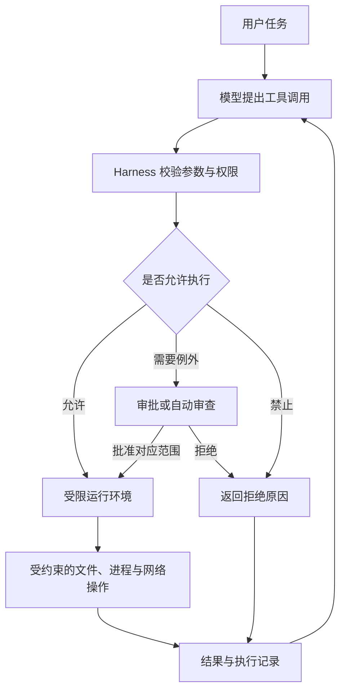
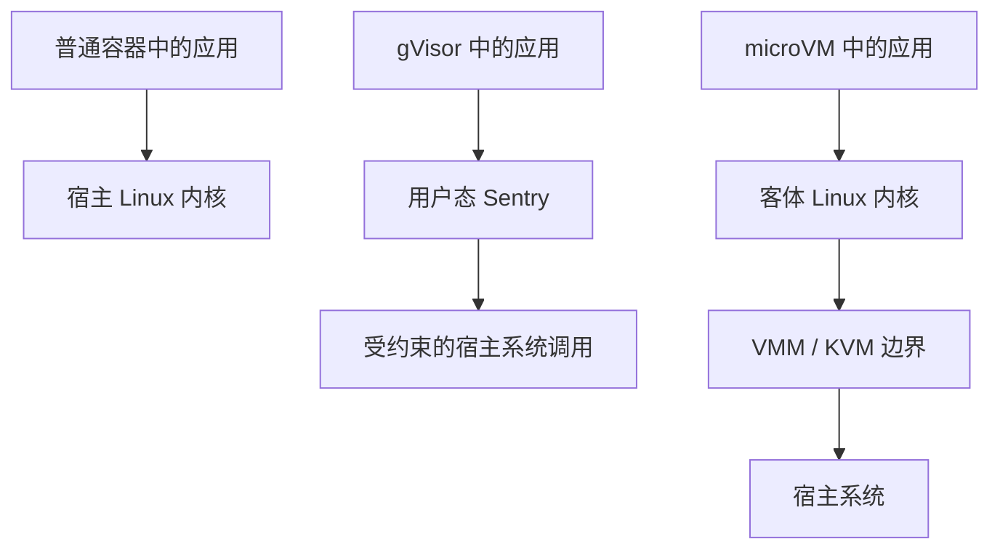

# 005｜Harness 沙箱：从 Codex CLI 到容器与 microVM

> 核对日期：2026-10-22。本机核对版本为 `codex-cli 0.163.0`，命令参数来自该版本的 `--help`；Codex 各平台实现与权限行为以同日官方文档为依据，不代表所有历史版本。
>
> 本文讨论 AI Agent 执行代码和调用工具时的安全边界。示例用于解释机制，未宣称已在所有平台运行验证；部署前应结合实际内核、运行时版本和组织策略检查。

让模型解释一段代码，与让模型执行一段代码，是两类工程问题。

前者主要处理上下文和输出质量；后者会触及文件、进程、网络、凭证，以及真实业务系统。一句“运行测试”，实际可能启动 Python、执行 npm 脚本、加载第三方插件，再生成一批子进程。

沙箱要解决的问题是：**即使模型判断出错，或者它执行的程序不可信，这次执行最多能影响哪些资源？**

Codex CLI 是一个很合适的观察入口。它既要读取真实项目、修改代码、运行工具链，又不能默认获得整台电脑的无限权限。沿着一次工具调用，就能理解 Harness 为什么需要沙箱，以及不同实现适合什么场景。

## 1. Harness、工具和沙箱分别负责什么

这里的 Harness 指围绕模型构建的运行系统，包括上下文管理、工具注册、调用分发、权限判断、审批、执行、结果收集和任务恢复等能力。不同项目的命名与模块边界会有差异。

模型生成的工具调用只是一份请求。它是否执行、在哪执行、以什么权限执行，应由模型之外的系统决定。

| 层次 | 核心职责 | 典型问题 |
| --- | --- | --- |
| 模型 | 选择下一步动作，生成工具参数 | 为了修复问题，接下来需要运行什么？ |
| Harness | 校验、授权、调度、记录与恢复 | 这次调用是否符合任务与策略？是否需要审批？ |
| 工具适配层 | 将调用转换为可执行操作 | 工作目录、参数、环境变量和超时是什么？ |
| 沙箱与运行时 | 实施文件、网络、进程等技术限制 | 被执行的程序实际上能访问什么？ |
| 操作系统或虚拟化层 | 提供底层隔离机制 | 内核凭什么拒绝一次访问？ |



“不要删除文件”是一条行为要求；文件系统把目标路径设为只读，才构成可执行的技术限制。两者可以同时存在，但承担的职责不同。

同样，工具名叫 `safe_exec`，或者 Python 代码用了 `subprocess`，都不能说明它已经具有隔离能力。关键要看子进程继承的权限与运行环境。

## 2. AI 为什么特别需要执行隔离

Agent 经常处理来源不同、可信程度不同的内容：用户需求、仓库源码、README、网页、Issue、构建日志、依赖包，以及其他工具返回的文本。

风险会沿着两条路径进入执行面。

第一条是**决策被影响**。例如网页中的恶意指令诱导 Agent 读取凭证并上传，或者把“排查构建失败”误导成修改系统配置。这通常属于提示注入问题。

第二条是**程序本身有副作用**。即使 Agent 正确地决定运行测试，测试代码、构建插件或安装脚本也可能读取环境变量、访问网络、启动其他进程。这里不需要模型先被说服，恶意代码就能直接运行。

因此，限制不能只放在“模型是否同意执行”这一层。它还应覆盖真正运行的程序及其后代进程。

一个实用的威胁模型至少要回答四个问题：

1. 哪些输入不可信，例如外部网页、陌生仓库、生成的脚本？
2. 要保护哪些资源，例如宿主机文件、其他租户、凭证和业务接口？
3. 允许哪些副作用，例如工作区编辑、指定域名联网、输出文件生成？
4. 哪些能力属于本次隔离范围，例如本地 shell、远程 MCP、浏览器和云端任务？

第四点尤其容易遗漏：本地 shell 被隔离，并不意味着远程服务调用也经过了同一个沙箱。

## 3. 用 Codex CLI 看懂“权限”和“审批”

### 3.1 两条独立的轴

Codex 官方文档把控制分成两个层次：沙箱规定技术边界；审批策略规定何时需要暂停并请求授权。[1][2]

常见沙箱模式如下：

| 模式 | 含义 | 需要注意的边界 |
| --- | --- | --- |
| `read-only` | 以检查和读取为主，不授予常规项目写入能力 | 能否执行某条命令仍与命令行为、审批及有效策略有关 |
| `workspace-write` | 允许在工作区等指定可写根目录内编辑与运行项目工具 | 并非所有可读路径都局限于工作区；网络由单独配置控制 |
| `danger-full-access` | 移除 Codex 自身提供的沙箱限制 | 仍受操作系统账户权限及外部容器等边界约束 |

本文核对版本的 CLI 帮助列出 `on-request` 和 `never` 两种审批选项：

- `on-request`：允许的操作在边界内执行；需要更多权限的动作可发起审批。
- `never`：不弹出审批请求；现有权限不够时，执行仍可能失败。

因此，下面两件事不能画等号：

```text
不再询问审批 ≠ 不再受到沙箱限制
```

官方还提供符合条件的自动审批审查机制。它改变的是请求交给谁审查，并不会自动移除工作区沙箱。[1]

### 3.2 常用启动方式

本地修改项目，可以明确选择工作区写入和按需审批：

```bash
codex --sandbox workspace-write --ask-for-approval on-request
```

只做审阅、又不希望非交互任务等待审批，可以使用：

```bash
codex --sandbox read-only --ask-for-approval never
```

需要操作另一个明确的项目目录时，可增加可写目录，而不是直接开放整个磁盘：

```bash
codex --sandbox workspace-write --ask-for-approval on-request \
  --add-dir /path/to/shared-library
```

`--add-dir` 扩大的是可写范围，不能把原有目录内的敏感文件自动隐藏起来。

对应配置示例：

```toml
approval_policy = "on-request"
sandbox_mode = "workspace-write"

[sandbox_workspace_write]
network_access = false
```

组织管理配置、权限配置和运行环境可能进一步限制这些设置。排查时应看有效权限，而不只看某一个配置文件。CLI 中可用 `/status` 查看会话状态，使用 `/permissions` 查看和调整可用权限模式。[1][2]

### 3.3 为什么代码能改，Git 操作却可能受限

`workspace-write` 不是把目录树无差别地设为可写。

根据核对日的官方文档，可写根目录中的 `.git`，以及存在的 `.agents`、`.codex`、`.aws` 等目录仍有只读保护。Git worktree 的 `.git` 若是指针文件，其指向的 Git 元数据路径也属于保护范围。[1]

这解释了一类常见现象：修改 `src/` 成功，但 `git add` 或更新 Git 元数据需要额外权限。

**工作区可写只是一种基础授权，里面仍然可以有更细的例外。**

### 3.4 一次测试命令的实际执行链

假设 Agent 提出执行 `npm test`：

1. Harness 接收命令、工作目录和运行参数，检查调用是否合法。
2. 根据有效规则判断是允许、需要审批，还是禁止。
3. 执行器准备工作目录、环境变量和进程，并应用对应平台的沙箱限制。
4. npm 启动测试框架，测试框架继续启动子进程；限制应继续覆盖这些子进程。
5. 执行器收集输出、退出状态和执行结果，交回 Harness。
6. 如果失败，Harness 区分代码错误、权限不足、依赖缺失、联网失败等情况，再决定下一步。

例如，测试把缓存写到工作区之外，或者首次运行要下载浏览器，都可能因为策略失败。这个结果不能直接证明代码有缺陷。

审批通过也不代表获得操作系统 root 权限。它可能允许某个目录、某次联网或更宽的执行上下文；具体授权范围取决于调用方式与实现。

## 4. Codex 的底层沙箱：同一策略，不同平台

### 4.1 macOS：Seatbelt

核对日的官方文档说明，macOS 使用 Seatbelt 策略，通过 `sandbox-exec` 为命令应用对应配置。[1]

可以把它理解为：执行器为子进程设置一份策略，由系统限制文件访问、联网等操作。它仍然是本机进程，通常不需要为每条命令启动完整虚拟机。

这适合本地编码：能利用已经安装的工具链，启动成本也较低。但它不自动提供独立内核、完整依赖环境或统一的 CPU、内存配额。

### 4.2 Linux / WSL2：bubblewrap 与 seccomp

当前官方文档描述的 Linux 默认实现是 **bwrap 加 seccomp**。bwrap 是 bubblewrap 的可执行程序，用于建立受限运行环境；seccomp 用于约束系统调用。[1][2]

理解它可以抓住两个层次：

- 通过命名空间、挂载等机制，安排程序能看到和修改的资源。
- 通过系统调用过滤等机制，减少程序可以使用的内核接口。

具体使用哪些命名空间、挂载选项和过滤规则，应以对应版本实现为准，不能只根据 `bwrap` 这个名字推断完整策略。

旧资料可能把 Codex Linux 沙箱概括为 Landlock。Landlock 本身仍是重要的 Linux 安全机制，但不应把旧版本的描述当成当前默认实现。官方文档记录，Codex 从 `0.115` 开始切换到 bwrap，WSL1 也因此不再支持该路径。[1]

如果 Codex 已在容器中运行，外层容器可能不允许创建内层沙箱所需的命名空间。此时要检查嵌套隔离的支持情况，并明确哪一层负责提供边界；不能把“内层创建失败”自动解释为“外层已经足够安全”。

### 4.3 Windows：需要区分原生环境与 WSL

原生 Windows 使用自己的沙箱实现；WSL2 使用 Linux 路径。

核对日官方文档列出 MXC、`elevated` 和 `unelevated` 三种原生实现：支持的设备可使用 MXC；后两者是旧实现的回退路径，其账户、ACL 和网络隔离能力并不相同。[3]

这里的 `elevated` 涉及需要管理员批准的初始化，不表示沙箱命令应以管理员身份运行。Windows 的这些差异也说明，产品层面相同的权限模式，不意味着底层技术完全一致。

## 5. 常见沙箱方案到底隔离了哪一层

### 5.1 系统级进程沙箱：限制现有进程能做什么

Seatbelt、Linux 安全模块、seccomp、命名空间等，经常组合使用。它们都能参与构建沙箱，但职责不同。

| 机制 | 主要回答的问题 | 不能直接替代的能力 |
| --- | --- | --- |
| namespaces | 进程看到哪组挂载、进程号、网络等资源？ | 完整访问控制、资源配额、独立内核 |
| seccomp | 可以调用哪些系统调用及部分参数组合？ | 文件路径策略、完整信息流控制 |
| Landlock / AppArmor / SELinux | 哪些资源访问受到策略限制？ | 单独完成依赖封装和所有资源配额 |
| capabilities / `no_new_privs` | 具有哪些特权，执行程序时能否获得新特权？ | 租户隔离、网络目标策略 |
| cgroups | CPU、内存、进程数等资源如何计量与限制？ | 文件内容保密和网络授权 |

Linux 内核文档特别指出：**系统调用过滤本身不是完整沙箱**。[4]

例如，传统 seccomp BPF 可以检查系统调用号和寄存器参数，但不能直接解引用参数指针，读取 `openat()` 传入的文件路径字符串。因此，不能简单写成“用 seccomp 白名单只允许访问 `/workspace`”。文件系统边界还需要挂载布局或访问控制等机制。

Landlock 则允许进程收紧自身及相关后代进程的资源访问权限，其可用能力与内核支持的 ABI 有关。[5]

此外，`chroot` 主要改变路径解析的根，单独使用不足以建立面向不可信代码的完整隔离。

### 5.2 普通容器：环境打包与宿主内核共享

Docker / OCI 容器把文件系统、进程视图、网络与资源限制组合成一个可管理单元。它很适合预装 Python、Node、编译器和依赖，让每次任务从一致环境启动。[6]

但普通 Linux 容器里的程序仍然调用宿主内核。容器 root 是否映射为宿主非特权用户、是否开启 rootless、挂载了哪些目录、是否暴露 Docker socket，都会改变实际边界。

下面是一个受限执行示例。假设当前目录只有本次任务需要的 `job.py` 和输入文件，镜像已由操作者预先准备：

```bash
docker run --rm \
  --network none \
  --read-only \
  --cap-drop ALL \
  --security-opt no-new-privileges \
  --user 10001:10001 \
  --pids-limit 128 \
  --memory 1g \
  --cpus 1 \
  --mount "type=bind,src=$PWD,dst=/workspace,readonly" \
  --tmpfs /tmp:rw,noexec,nosuid,size=128m \
  --workdir /workspace \
  --env PYTHONDONTWRITEBYTECODE=1 \
  python:3.13-slim \
  python /workspace/job.py
```

这条命令分别限制了网络、根文件系统写入、Linux capabilities、提权、进程数、内存、CPU 和输入目录写入，并提供有限的临时空间。Docker 默认 seccomp 配置仍由所用环境决定，示例没有自定义完整系统调用策略。

几个边界必须读清楚：

- 输入目录只读，里面的文件仍然可读，所以应使用专门的任务输入目录。
- `--network none` 限制的是运行中的容器，不负责限制宿主 Docker 拉取镜像时的网络。
- 示例没有限制墙钟运行时长，也没有回收输出产物，调度器仍需完成这些职责。
- 示例无法写回源码；需要产出文件时，应增加专门的可写输出挂载并设置容量限制。

依赖安装、浏览器和 JIT 编译可能需要不同的临时目录或执行权限，应根据实际任务调整。生产镜像还应使用经过验证的版本与 digest 固定环境。

尤其不要把宿主的 `/var/run/docker.sock`、完整家目录或生产凭证直接挂进通用执行容器。对宿主 Docker daemon 的控制能力，可能让容器重新获得很大的宿主访问范围。[6]

### 5.3 gVisor：用用户态应用内核承接系统调用

gVisor 的核心是 Sentry，一个在用户态实现 Linux 接口的应用内核。应用的系统调用先由 Sentry 处理，而不是直接完整暴露给宿主 Linux 内核；文件系统访问等还涉及 Gofer 等组件。[7]

它提供 OCI runtime `runsc`，可以融入 Docker、Kubernetes 等现有容器工具链。

它的价值是缩小不可信应用直接接触宿主内核的接口面。代价是部分系统调用或系统接口兼容性，以及系统调用密集任务的额外开销。因此，执行依赖复杂的原生程序前，需要实际验证工作负载。

gVisor 的隔离方式既不同于普通系统调用过滤器，也不同于运行完整客体内核的虚拟机。

### 5.4 microVM：为工作负载提供独立客体内核

Firecracker 使用 KVM 创建 microVM。程序运行在客体操作系统中，系统调用由客体内核处理，再通过虚拟化接口与宿主交互。[8]



这条路径适合运行来自不同用户的不可信代码，以及需要更明确租户边界的云端执行平台。

Firecracker 通过精简设备模型减少攻击面，并提供 jailer 等额外防护。不过，完整产品仍需要实现镜像构建、网络、存储、任务调度、健康检查、回收与配额。

microVM 并不会自动解决凭证外泄：如果把长期密钥放入虚拟机，再允许任意联网，里面的恶意程序仍可以使用或发送这些密钥。

也不应仅根据“micro”就推断实际启动延迟或密度。镜像、内核、预热方式、存储、网络和任务依赖都影响最终表现。

### 5.5 WASM / WASI：用运行时能力接口缩小执行面

WebAssembly 通过线性内存边界、控制流约束和显式导入接口，为模块建立运行时边界。WASI 的文件系统访问采用能力模型，只给模块提供被授予的目录或资源。[9]

它很适合规则计算、格式转换、插件等接口较小的任务。如果一个工具只需要输入 JSON 并返回 JSON，未必需要开放完整 shell。

但任意 Python 生态、原生动态库、复杂 POSIX 程序、GPU 和浏览器工作负载，并不能总是直接搬到 WASM。宿主暴露的函数、运行时漏洞、CPU 与内存预算，也仍然需要治理。

### 5.6 云沙箱服务：提供的是执行产品接口

E2B 等产品把创建环境、执行命令、文件传输、暂停和恢复封装为 SDK。[10] 这是服务形态，不能仅凭“云沙箱”这个名称判断底层一定是普通容器、gVisor 还是 microVM。

接入时需要核实当前产品的执行边界、网络默认值、凭证注入方式、存储生命周期和销毁行为。自建与采购的区别在于谁负责维护执行基础设施；Harness 的授权和业务控制仍然需要自己设计。

## 6. 怎么选：先看工作负载与信任边界

| 场景 | 常见选择 | 优先验证的内容 |
| --- | --- | --- |
| 在自己的电脑上修改已知项目 | Codex 这类系统级进程沙箱 | 可读、可写路径，联网例外，受保护目录 |
| 为项目提供统一工具链 | Dev Container / 普通容器，可叠加内部沙箱 | 挂载、账户权限、依赖、内层隔离是否可用 |
| 多用户提交脚本或陌生仓库 | gVisor、microVM 或相应托管执行平台 | 租户边界、内核接口、配额、网络和销毁 |
| 运行接口受控的小型插件 | WASM / WASI | 导入能力、超时、内存、宿主函数权限 |
| 处理表格、绘图、数据分析 | 独立短生命周期执行环境 | 数据目录、输出校验、依赖与资源上限 |
| 浏览器或桌面 Agent | 独立浏览器上下文与隔离的进程、容器或 VM | 登录态、站点权限、上传下载和外部操作 |

这些方案可以组合。例如，microVM 里面继续使用容器管理依赖，容器内继续应用文件策略。增加层数不等于自动得到更好的策略；每层都应有明确职责。

浏览器的无痕上下文主要隔离会话状态，不能单独当成抵御任意宿主代码执行的完整边界。浏览器进程的系统隔离与网站操作授权还需要分别设计。

## 7. AI 场景中的三类关键用法

### 7.1 Coding Agent：让真实工具链在受限范围内运行

编码任务需要编辑文件、运行编译器、测试框架和包管理器，因此不能只用一个极小的表达式解释器。

常见做法是限定工作区，把依赖与缓存放到可管理路径，为联网或工作区外写入提供明确的例外流程。陌生仓库则可以放进单独容器或 VM，避免直接继承日常开发环境中的凭证。

要注意，`npm test`、`pytest`、构建命令都可能执行仓库里的任意代码。“这是测试命令”不是免于隔离的理由。

### 7.2 数据分析 Agent：输入受控，产物可提取

用户上传 CSV，模型生成 Python，执行后返回图表，是典型的沙箱用法。

适合的目录设计可以是：

```text
/input    仅本次任务的数据，默认只读
/work     任务临时空间，限制容量
/output   允许提取的产物，限制类型和大小
```

任务结束后，由可信服务校验产物路径、文件大小和实际格式，再复制到持久存储。不要让模型自由指定宿主任意路径作为下载产物。

超大文件、符号链接、HTML / SVG 中的主动内容，以及压缩包解压路径，都可能让“取回一个结果文件”变成新的攻击入口。

### 7.3 企业工具 Agent：操作授权通常比代码隔离更关键

给 CRM 发请求、修改工单、发送邮件、部署系统，副作用经常发生在远程服务端。

即使请求由一个完全隔离的进程发出，只要携带的凭证允许删除全部客户，它仍有能力执行这个业务操作。

这类系统通常需要将执行环境与凭证使用分开：模型提出结构化业务请求，可信网关校验对象、动作、租户和额度，再使用范围受限的凭证完成调用。对重要写操作增加预览、审批和幂等机制。

因此，本地 shell 的网络开关，不是 MCP、连接器、模型 API 和所有浏览器操作的总开关。Codex 官方也明确区分命令网络代理与这些其他连接路径。[1]

## 8. 文件、网络、资源：三个容易混淆的维度

### 8.1 文件系统：只读不等于保密

把目录设为只读，只能阻止其中一类修改行为，不能阻止程序读取并输出内容。

沙箱能读取 `.env`，就可能把内容写进日志或工具结果；即使它完全不能直接联网，结果仍可能经 Harness 进入模型上下文，或进入其他持久化系统。

所以“命令网络被禁用”不等于数据不会离开电脑。对于涉及托管模型的任务，读取策略、上下文发送范围与日志策略必须一起考虑。

路径判断也不能只用字符串前缀。例如检查路径以 `/work` 开头，无法区分 `/work` 与 `/work-other`；`..`、符号链接和检查后的路径替换还会带来更多问题。

稳妥实现需要明确目录边界，结合运行时的文件系统限制，以及基于目录句柄的安全路径解析等方式，处理检查与使用之间的竞态。应用层路径校验和系统层访问限制各有职责。

### 8.2 网络：能访问不等于只能访问需要的服务

Codex 的 `workspace-write` 默认关闭命令网络访问。启用网络是一个决定；限制目标域名，是另一个决定。[1]

按核对日文档，命令网络访问已启用时，还需要启用网络代理功能，配置域名规则才会通过该代理实施限制。只写一个域名 allow 规则，不能假定它已经拦截所有直连路径。

对自建执行平台，代理或网络层还应考虑 DNS、重定向、私网地址、回环地址和云元数据接口。只检查用户提交的 URL 字符串，不能保证实际连接目的地安全。

目标域名白名单也不能解决全部数据外传问题：被允许的服务可能具有文件上传功能，同一域名下也可能存在用户可控端点。

### 8.3 资源：隔离之外还要控制消耗

程序即使只能访问任务目录，仍可能无限循环、创建过多进程、写满磁盘或输出海量日志。

资源治理通常需要组合使用：

- CPU、内存和进程数限制。
- 临时存储、文件数与产物大小限制。
- 单次命令的墙钟超时与整个任务的预算。
- stdout / stderr 的有界采集、背压和截断标记。
- 对进程组、cgroup、容器或 VM 整体执行取消与回收。

“最多执行 30 秒”和“最多使用 1 核 CPU”是不同约束。只给 shell 父进程发送终止信号，也不保证后代进程已经停止。

## 9. 自己实现 Harness，执行器接口应该表达什么

执行接口最好明确表达运行边界，而不是只有一个命令字符串。以下是设计示意，不是 Codex 的真实协议：

```json
{
  "task_id": "task-005",
  "argv": ["python", "/work/analyze.py"],
  "cwd": "/work",
  "input_mounts": [{"source_id": "dataset-42", "target": "/input", "read_only": true}],
  "writable_paths": ["/work", "/output"],
  "network_profile": "offline",
  "environment_profile": "python-analysis-v3",
  "limits": {
    "wall_time_seconds": 30,
    "memory_mib": 512,
    "pids": 64,
    "output_bytes": 1048576
  }
}
```

这里的 `source_id`、镜像、网络配置和宿主挂载路径，都应由可信控制面解析与授权。不能让模型提交 `writable_paths`，服务端就照单全收；否则权限字段只是一个扩大权限的入口。

能用结构化 `argv` 的工具，优先避免不必要的 shell 展开。但这只减少命令拼接风险，Python 脚本或程序参数仍然可能产生任意副作用，沙箱依然需要存在。

结果也应表达失败类别，以下同样是建议结构：

```json
{
  "status": "denied",
  "exit_code": null,
  "stdout": "",
  "stderr": "",
  "truncated": false,
  "reason": "network_not_allowed",
  "retryable": false
}
```

可以区分 `denied`、`approval_required`、`timeout`、`resource_exhausted`、`exited` 和 `cancelled` 等状态。退出码、内核事件和运行时信息能判断多少，就报告多少，不要从一段 stderr 凭空推断出精确原因。

无权限时，Agent 可以改用已有依赖、减少任务范围或提出具体例外请求；不应在多个工具之间反复换路径，尝试达到同一个被禁止的效果。

## 10. 生命周期、凭证与审计同样属于设计的一部分

一个执行环境通常经历：

```text
选择模板 → 创建环境 → 注入必要输入 → 执行任务
        → 校验并提取产物 → 撤销访问与回收资源
```

模板适合存放工具链和公共依赖，不适合固化用户私钥或生产令牌。运行阶段尽量使用短期、限范围的凭证，或者通过可信代理完成需要身份的操作。

容器或 microVM 销毁后，外部卷、对象存储、构建缓存和日志未必一起消失；暂停与快照还可能保留内存里的凭证。跨用户复用环境时，应把状态归属、清理和恢复权限纳入设计。

审计记录可以关联任务、策略版本、镜像版本、工具调用、审批范围、耗时、退出结果和产物标识。记录这些元数据有助于复现；对参数和输出应脱敏，避免审计系统变成新的凭证仓库。

代码修改完成后，也仍然需要 diff 检查、测试和业务审阅。沙箱约束访问范围，并不能证明生成的代码正确，或者工作区内的每一次删除都符合用户意图。

## 11. 如何验证边界真的生效

验证时应同时覆盖“预期允许”和“预期拒绝”的行为，并在临时测试环境中使用虚构数据。

| 维度 | 应允许的样例 | 应拒绝或受控的样例 |
| --- | --- | --- |
| 文件 | 修改任务输出目录的临时文件 | 修改策略明确保护的测试目录 |
| 路径 | 读取授权输入文件 | 通过 `..` 或符号链接访问未授权测试目录 |
| 网络 | 访问明确允许的测试服务 | 访问未授权公网、私网或回环目标 |
| 子进程 | 启动一个有界测试进程 | 子进程获得比父进程更大的权限 |
| 资源 | 在预算内完成计算 | 内存、时间或日志超限后仍无限运行 |
| 生命周期 | 提取本任务合法产物 | 上一个租户的文件出现在新任务中 |
| 工具范围 | 本地命令按预期受限 | 误认为远程 MCP 会自动继承本地限制 |

对 Codex，先检查 `codex --version`、`codex --help` 和 `codex sandbox --help`，再按本机支持的语法做临时目录探针。底层沙箱调试子命令可能随版本与平台变化，不宜照抄旧文章的参数。

如果系统缺少所需隔离能力，应当明确失败或切换到已经确认的外层边界；默默降级成无限制宿主执行，会让权限策略失去意义。

## 12. 回到 Harness：让自主执行建立在明确边界上

Codex CLI 展示了一种适合本地开发的实现方式：模型提出操作，Harness 管理任务和权限，系统沙箱限制实际执行，需要例外时进入审批流程。

云端多租户执行通常还要引入容器、gVisor 或 microVM，解决环境交付和租户隔离；小型受控插件则可以考虑 WASM。调用企业服务时，还要把远程授权、凭证与业务副作用纳入同一条控制链。

设计一个 Agent 执行系统时，最应该能明确回答的是：**这个动作由谁授权，在哪个环境执行，能读写什么，能连接哪里，失败后如何停止，最后留下哪些状态？**

这几个答案越具体，Harness 就越能在减少无谓审批的同时，让 Agent 稳定地完成真实工作。

## 参考资料

1. [OpenAI：Agent approvals & security](https://learn.chatgpt.com/docs/agent-approvals-security)：沙箱模式、审批、保护路径、平台实现和命令网络控制。
2. [OpenAI：Sandbox](https://learn.chatgpt.com/docs/sandboxing)：跨客户端的沙箱概念、bubblewrap 前提与权限入口。
3. [OpenAI：Windows sandbox](https://developers.openai.com/codex/windows/windows-sandbox)：MXC 与 legacy 实现的差异。
4. [Linux kernel：Seccomp BPF](https://docs.kernel.org/userspace-api/seccomp_filter.html)：系统调用过滤的能力与边界。
5. [Linux kernel：Landlock](https://docs.kernel.org/userspace-api/landlock.html)：非特权访问控制及 ABI 兼容性。
6. [Docker：Docker Engine security](https://docs.docker.com/engine/security/)：namespaces、cgroups、capabilities 与 daemon 攻击面。
7. [gVisor：What is gVisor?](https://gvisor.dev/docs/)：Sentry、Gofer、`runsc` 与兼容性权衡。
8. [Firecracker：官方介绍](https://firecracker-microvm.github.io/)：KVM、microVM、精简设备模型与 jailer。
9. [Wasmtime：Security](https://docs.wasmtime.dev/security.html)：WebAssembly 隔离、显式导入与 WASI 能力模型。
10. [E2B：官方文档](https://e2b.dev/docs)：沙箱 SDK、模板与环境生命周期。
