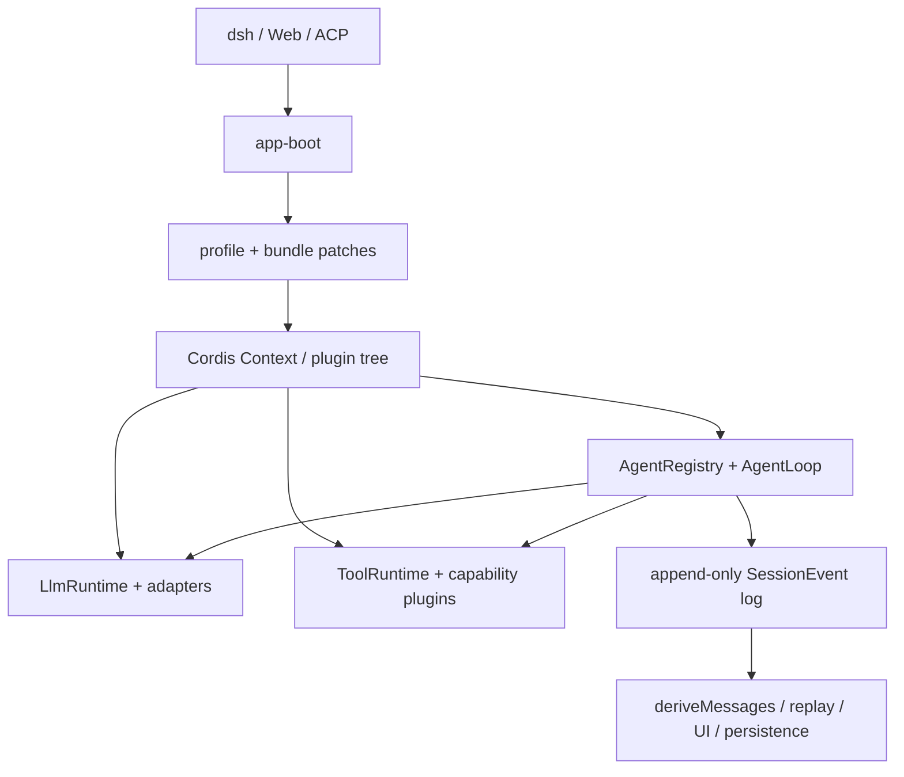

# DeepSeek Harness 源码架构导读

[English](https://github.com/deepseek-ai/deepseek-harness/blob/master/docs/source-architecture.md) | 中文

本文面向需要理解或修改仓库源码的研发人员，解释代码如何组装成一个运行中的 agent harness（智能体框架），以及不同改动应落在哪一层。[架构地图](architecture.zh.md)仍是精简的系统总览；子系统类型和完整公开 API 仍以[子系统参考](subsystems/README.zh.md)为准。

下文只摘录能说明机制的少量源码，并链接到其归属文件。修改前应继续阅读上下文；仓库源码才是权威实现。

## 一张图看懂系统



整个设计建立在 4 个核心原则上：

- **组合结果就是应用。** profile 叠加多个组合包 patch，生成 Cordis 插件树；Web 和 headless 通过组合形成不同运行模式，而不是维护两套内核。
- **服务提供能力，事件提供拦截。** 插件通过 `ctx` 服务获取稳定能力，通过类型化事件观察或改变实时行为。
- **会话日志是模型可见信息的真源。** agent loop（智能体循环）每次都从持久事件重建请求，不维护第二份可变对话历史。
- **完整的能力 seam 可被替换。** Service Definition、一个或多个 Service Provider 与 Consumer 隔离 agent loop 和文件系统、子进程、模型厂商、持久化后端等具体环境。

## 源码分层与职责

| 层次 | 主要位置 | 职责 |
|---|---|---|
| 框架层 | `vendor/cordis/` | 插件生命周期、`Context`、服务、类型化事件、副作用、依赖注入和 loader 原语 |
| 启动与组合层 | `packages/boot/`、`packages/bundle/`、`packages/preset/` | 解析 profile、应用 patch 层、挂载插件树，并拒绝不完整的启动状态 |
| 产品主干 | `packages/core/session`、`system-prompt`、`tools`、`agent`、`agent-loop` | 管理持久对话状态、提示词与工具组装、agent 句柄和默认轮次驱动器 |
| 能力 seam | `packages/llm`、`fs`、`subprocess`、`shell`、`terminal`、`web`、`subagent` 等目录 | 声明能力 API、实现提供方，并暴露面向模型的工具等 Consumer |
| 接入与传输层 | `packages/api`、`sdk`、`acp`、`client`、`host`、`examples` | 驱动 agent，并把持久状态投影到 CLI（命令行界面）、RPC、ACP（Agent Client Protocol）和浏览器 |
| 分发层 | `packages/bundle/base`、`web-app`、`headless` | 选择交付的插件和部署默认值，不把具体插件导入 agent loop |

包边界按职责划分，而不是按调用深度划分。例如，`agent-loop` 负责调度工具调用，但不实现文件访问；它调用 `ctx.tools`，注册的工具定义再使用 `ctx.fs`、`ctx.shell` 或其他提供方。

## 启动：配置如何变成插件树

profile 列出组合包，每个组合包通过 `cordis.patch.yml` 声明配置项；profile 和命令行还可以追加更高优先级的 patch 层。组合器从空列表开始顺序应用所有层，后面的层按稳定 id 替换或插入配置项。

组合核心非常小（[源码](https://github.com/deepseek-ai/deepseek-harness/blob/master/packages/boot/app-boot/src/profile.ts#L413)）：

```typescript
export function composeEntries(
  layers: readonly PatchOptions[][], warn: (message: string) => void = () => {},
): EntryOptions[] {
  return applyEntryPatches([], structuredClone(layers.flat()), (message: string, ...args: unknown[]) => {
    let index = 0
    warn(message.replace(/%C/g, () => JSON.stringify(args[index++])))
  })
}
```

1. `layers.flat()` 保留组合包、profile、home 和 CLI overlay 的原始优先级。
2. `structuredClone()` 防止 loader 修改解析后的源对象。
3. `applyEntryPatches([], ...)` 表明最终插件树完全由有序 patch 推导，没有隐藏的基础配置。
4. 稳定的配置项 id 就是定制接口。替换某项的 `config` 会替换整个配置，因此 overlay 必须完整写出自己负责的配置键。

`boot()` 随后创建唯一的根 `Context`、安装 loader、挂载一个根 include、等待所有 fiber 完全停稳，并审计激活结果（[源码](https://github.com/deepseek-ai/deepseek-harness/blob/master/packages/boot/app-boot/src/index.ts#L757)）：

```typescript
export async function boot(
  binName: string,
  absoluteConfigPath: string,
  patches?: PatchOptions[],
  prepare?: (ctx: Context) => Promise<void> | void,
  bareModuleBaseUrl?: string,
): Promise<Context> {
  const ctx = new Context()
  let stage = 'host preparation failed'
  try {
    ctx.baseUrl = pathToFileURL(dirname(absoluteConfigPath)).href + '/'
    ctx.provide('dshHomePath', dshHomePath)
    await ctx.plugin(Loader)
    await prepare?.(ctx)
    stage = 'plugin tree failed to load'
    await mountRootInclude(ctx, absoluteConfigPath, patches, bareModuleBaseUrl)
    await ctx.get('loader')?.await()
    if (ctx.get('loader') === undefined) return ctx
    await assertEntriesActivated(ctx, binName)
    return ctx
  } catch (cause) {
    await ctx.fiber.dispose()
    const detail = cause instanceof Error ? cause.message : String(cause)
    let deepest: unknown = cause
    while (deepest instanceof Error && deepest.cause !== undefined) deepest = deepest.cause
    const stack = deepest instanceof Error && deepest !== cause ? `\n${deepest.stack ?? deepest.message}` : ''
    throw new Error(`${binName}: ${stage}: ${detail}${stack}`, { cause })
  }
}
```

这里最重要的生命周期规则是启动必须快速失败：包无法解析、插件初始化拒绝、注入服务缺失或 fiber 一直 pending，都会让应用启动失败，而不是静默丢失某项能力。错误向外抛出前，根 fiber 会先 dispose（资源释放），已经挂载的副作用因此能够按所有权撤销。

基础组合包体现了组合与实现的分离。它的 patch 按包名挂载会话、LLM（大语言模型）、工具、持久化、沙箱、审批、skill（技能）等插件；该组合包的 TypeScript 模块没有运行时逻辑。Web 与 headless 组合包只覆盖公共配置项并插入各自的接入层插件。

## Cordis 运行时：服务、事件与副作用

每个插件都运行在一个 `Context` 中，几乎所有跨包交互都由 3 种机制完成：

| 机制 | 适用场景 | 核心特性 |
|---|---|---|
| `ctx` 服务 | 提供具名能力的方法或注册表 | Consumer 依赖服务定义，不依赖具体提供方 |
| 类型化事件 | 观察、策略或协作式拦截 | 事件声明合并让插件扩展事件表，无需维护中央枚举 |
| `ctx.effect()` / `ctx.on()` | 注册项和资源所有权 | 插件卸载时执行返回的 disposer |

因此，所有注册都必须是副作用。工具、适配器、提示词片段、路由或事件监听器如果比所属插件活得更久，HMR（热模块替换）和 agent 级组合都会失去安全性。注册表会返回精确 disposer；agent 局部贡献则通过 `agent.ctx` 注册，并随该 agent 一起撤销。

waterfall（瀑布式事件）是协作式中间件。监听器可以返回自己的决定来短路后续链路，也可以调用 `next()` 继续委托。不调用 `next()` 会改变行为，不是无害的提前返回。

## Agent 运行时：句柄与驱动器分离

`@deepseek-ai/dsh-agent` 管理稳定的 `Agent` 接口和活跃注册表；`@deepseek-ai/dsh-agent-loop` 注册默认工厂并实现可变驱动器。因此，接入层、SDK 网关、subagent 提供方和扩展只依赖 `Agent`，不需要导入默认循环。

每个 `Agent` 只有一个 inbox，但投递语义明确区分：

- `followup()` 排入下一个普通轮次，并唤醒空闲驱动器。
- `steer()` 指向最近的步骤边界，并唤醒驱动器。
- `inject()` 把模型可见上下文放入下一次获准的步骤，但不会唤醒空闲驱动器。
- `cancel()` 协作式中止当前活动；`whenIdle()` 观察整个 agent 是否完全停稳。

驱动器管理一个阶段状态机（`idle`、维护任务或运行中）、当前活动唯一的 abort controller、单调递增的轮次／步骤坐标，以及取消收敛期间接收新输入的唤醒锁存。

## 从源码跟踪一个轮次

轮次方法先打开持久边界再领取输入，通过 `agent/pre-step` 提议每个步骤，并在 `finally` 中关闭所有已打开边界。下方摘录保留这条生命周期顺序，省略了错误标准化分支（[源码](https://github.com/deepseek-ai/deepseek-harness/blob/master/packages/core/agent-loop/src/agent.ts#L245)）：

```typescript
const turn = phase.turn + 1
try {
  this.session.append('turn/start', { turn })
} catch (error: unknown) {
  this.throwError(error)
}
phase.turn = turn
let turnEnds: TurnEndReason | null = null
let target: InboxTarget = 'next-turn'
try {
  while (true) {
    signal.throwIfAborted()
    const step = phase.step + 1
    const decision = await this.preStep(target, { turn, step })
    if (decision.kind === 'reject') {
      turnEnds = { kind: 'blocked' }
      return false
    }
    if (turnEnds && decision.messages.length === 0) break
    if (phase.step === 0 && decision.messages.length === 0) {
      turnEnds = { kind: 'completed' }
      return false
    }
    signal.throwIfAborted()
    this.session.append('step/start', { turn, step })
    phase.step = step
    try {
      for (const message of decision.messages) {
        this.session.append('user/message', message, { surfaceOp: 'append' })
      }
      const stepEnd = await this.step(decision.assembly)
      if (turnEnds === null || turnEnds.kind !== 'max-tokens') turnEnds = stepEnd
    } finally {
      this.session.append('step/end', { turn, step })
    }
    signal.throwIfAborted()
    if (turnEnds && this.inbox.nextStep.length === 0) {
      await this.dispatch.serial('agent/turn-stopping', { turn, signal })
      signal.throwIfAborted()
    }
    if (turnEnds && this.inbox.nextStep.length === 0) break
    target = 'next-step'
  }
} finally {
  this.session.append('turn/end', { turn, reason: turnEnds! })
}
```

这段顺序编码了多个产品约定：

1. 首次提议被拒绝或改写为空，仍会留下配平的 `turn/start` / `turn/end`，因此持久日志能够记录这次轮次尝试。
2. `agent/pre-step` 先于 `step/start`；策略可以拒绝或改写输入，而不会制造一个不存在的模型步骤。
3. 获准消息会在请求构建前写成 `user/message` 事件，模型可见输入因此可以重建。
4. 工具要求续跑或已排队的 steering（中途引导）会让循环从 `next-step` 继续；普通排队提示词仍属于独立轮次。
5. `step/end` 和 `turn/end` 在 `finally` 中写入，取消和失败也能形成闭合的生命周期区间。

`step()` 内部会渲染已经组装的系统提示词、调用 `session.deriveMessages()`、通过 `agent/request` 解析生效的提供方／模型，再用 `ctx.llm.prepareCall()` 绑定具体适配器注册项，并记录生效请求 header。模型流中的 `assistant/chunk` 由 `BlockAssembler` 组装为一条 `assistant/message`；如果其中包含工具调用，循环再执行这些内容块。工具结果会作为下一步骤的上下文进入 inbox，因此下一个模型请求仍通过同一条持久链路重建。

## 会话日志：一份记录，多种投影

`Session` 是仅追加的类型化 `SessionEvent` 信封序列，每条记录带有单调递增的 `seq` 和时间戳。核心生命周期事件、用户与助手消息、工具调用与结果、请求 header，以及插件定义的持久状态共用这条事件流。

`deriveMessages()` 不读取另一份消息数组，而是先折叠当前会话展示序列，再只映射会产生模型消息的事件类型（[源码](https://github.com/deepseek-ai/deepseek-harness/blob/master/packages/core/session/src/surface.ts#L83)）：

```typescript
export function eventToMessage(event: SessionEvent): Message | null {
  switch (event.type) {
    case 'user/message': {
      return event.data
    }
    case 'assistant/message': {
      if (event.data.message.content.length === 0) return null
      return event.data.message
    }
    case 'tool/result': {
      return event.data.message
    }
    default:
      return null
  }
}
```

同一份日志支持不同投影，而不为它们建立新的真源：

- 模型请求使用有序消息展示序列。
- UI 与传输层监听 `session/event`，渲染分片、边界、状态和工具进度。
- 持久化后端存储事件信封，并通过回放恢复 `Session`。
- fork 把一个已确认的事件边界复制到子会话。
- 压缩（compaction）发出带 `surfaceOp` 的替换事件，遮蔽较早的可见区间，同时保留来源关系。

新增模型可见状态时，应先定义持久 `SessionEventMap` 成员，在归属的生命周期位置追加事件，再让展示投影把该事件渲染成消息。把临时数据直接塞进请求，会同时破坏回放、恢复、fork、遥测和 UI 一致性。

## 工具执行：策略包围具体实现

工具定义会注册 schema、执行函数、结果渲染、并发元数据、超时意图和 UI 展示信息。agent loop 不直接调用工具定义，而是向 `ToolRuntime` 提交 `ToolExecutionInput`。

公开执行方法把调用交给显式的分阶段结果联合类型（[源码](https://github.com/deepseek-ai/deepseek-harness/blob/master/packages/core/tools/src/index.ts#L1342)）：

```typescript
async execute(exec: ToolExecutionInput): Promise<ToolExecutionResult> {
  return this.prepareExecution(exec, prepared => this.completeScheduledExecution(prepared))
}

private async completeScheduledExecution(prepared: ScheduledToolPreparation): Promise<ToolExecutionResult> {
  switch (prepared.kind) {
    case 'dispatch': {
      const dispatched = await this.dispatchScheduledExecution(prepared.exec)
      return dispatched.kind === 'post-result'
        ? await this.finalizeScheduledExecution(prepared.exec, dispatched.result)
        : this.finishScheduledExecution(prepared.exec, dispatched.result)
    }
    case 'post-result':
      return await this.finalizeScheduledExecution(prepared.exec, prepared.result)
    case 'final-result':
      return this.finishScheduledExecution(prepared.exec, prepared.result)
    default:
      return assertNever(prepared, 'scheduled tool preparation')
  }
}
```

各阶段的语义不同：

1. **创建：**复制 JSON 参数、解析作用域可见性、分配关联身份，并捕获取消状态。
2. **执行前：**运行 `tools/pre-execute`、处理审批请求，再执行单调保护规则。
3. **分发：**运行 `tools/execute` 包装层并调用已注册实现；已经启动的实现即使收到取消也会结算完成。
4. **执行后：**运行 `tools/post-execute`，允许修正输出或按策略阻止结果。
5. **物化：**校验结构化值、渲染模型可见内容、冻结结果并通知观察方。

agent-loop 调度器在这条流水线之上增加顺序和并发控制。允许并行的调用可以在有界池中重叠，独占调用形成屏障。调用体可以并发执行，但 `tool/call`、最终策略、`tool/result` 和结果上下文仍按模型给出的顺序提交，从而保持确定性回放。

## LLM 运行时：模型提供方也是可替换能力

`LlmRuntime` 是按名称注册的适配器目录。agent loop 先通过 `prepareCall()` 解析调用，得到绑定到具体适配器注册项的一次性句柄。该句柄冻结解析后的模型配置、能力上下文、重试策略，以及哪些默认值来自适配器。

这种绑定在 HMR 期间很重要：能力查询和实际分发不能意外使用同一提供方的两个不同版本。agent loop 在分发前记录解析后的请求 header，使提供方／模型变化和适配器默认值都可以重建。适配器选择、迭代器创建和流迭代失败会被标准化为终止分片；中间件与消费方失败仍作为对应插件负责的普通异常抛出。

## 能力 seam：基础设施如何保持可替换

完整的能力 seam 包含 3 种角色：

| 角色 | 常见代码 | 职责 |
|---|---|---|
| Service Definition | `Service` 类、请求／结果类型、事件 | 稳定的能力词汇和与提供方无关的行为 |
| Service Provider | 本地、远程、沙箱或厂商插件 | 实现服务，并校验部署相关配置 |
| Consumer | 面向模型的工具、循环插件、Host 网关 | 把产品意图转换为服务调用 |

文件系统调用链可以直观看出依赖方向：

```text
AgentLoop -> ToolRuntime -> dsh-tool-fs -> ctx.fs -> local/sandbox/remote provider
```

替换 `ctx.fs` 就能改变所有文件系统 Consumer，无需在 agent loop 或工具协议中增加分支。子进程、shell、终端、Web、工作流、subagent、持久化、设置、凭据和审批都采用相同模式。共享一个执行环境的文件系统与子进程提供方必须成对组合，确保路径与进程指向同一环境。

## 一项改动应该放在哪里

| 需求 | 正确归属 |
|---|---|
| 新增或替换模型厂商 | 注册到 `ctx.llm` 的 LLM 适配器 Service Provider |
| 新增面向模型的操作 | 注册到 `ctx.tools` 的工具 Consumer，后接已有或新增的能力 seam |
| 新增请求策略或路由 | `agent/request` waterfall 监听器 |
| 新增或改写获准上下文 | `agent/pre-step`；模型可见材料还要追加为会话事件 |
| 新增工具审批、拒绝、包装或输出过滤 | `tools/pre-execute`、`tools/execute` 或 `tools/post-execute` |
| 新增持久对话状态 | `SessionEventMap`、追加位置、投影、持久化／SDK 文档和快照覆盖 |
| 新增后端 | 归属 Service Definition 后的 Service Provider；不要在 Consumer 中增加提供方分支 |
| 只改变一种部署模式 | 组合包／profile patch 层；运行时行为本身变化时除外 |
| 改变轮次／步骤语义 | `agent-loop`，同时更新架构、生命周期文档和组装应用快照 |
| 只对一个 agent 生效 | 通过 `agent.ctx` 注册，而不是根上下文 |

一个实用判断是：如果功能可以通过已有服务或事件表达，就不应进入 `agent-loop`。循环只负责顺序、生命周期闭合、请求重建、取消收敛和工具调度；领域策略属于插件。

## 阅读与排障路径

遇到不熟悉的行为时，按以下顺序定位：

1. 运行 `dsh --profile <name> --dump-config`，确认生效的插件配置项和覆盖关系。
2. 在 `packages/bundle/*/cordis.patch.yml` 中找到配置项，再阅读对应包 README 的配置和行为约定。
3. 从调用点确认使用的 `ctx` 服务或类型化事件；定位事件时，生成的[事件生产方／消费方映射](event-producer-consumer.zh.md)比全仓文本搜索更直接。
4. 排查模型输出时，先检查会话事件顺序：获准的 `user/message`、`request/header`、`assistant/chunk`、`assistant/message`、`tool/call` 和 `tool/result`。
5. 排查启动问题时，检查 loader 激活结果和缺失的注入服务；禁用配置项是有效状态，启用但 pending 的 fiber 不是。
6. 排查取消或资源释放问题时，修改代码前先读[防御性模式](defensive-patterns.zh.md)，并确认哪个插件拥有相关副作用或 abort signal。

完成本导读后，再进入更窄的归属参考：[agent 生命周期](agent-lifecycle.zh.md)、[工具执行](tool-execution-pipeline.zh.md)、[能力 seam](capability-seams.zh.md)、[配置目录](config-catalog.zh.md)和各包 README。

## 架构设计评价

总体而言，这套架构适合需要在同一运行时中支持多个模型厂商、执行环境、交互界面和部署策略的 agent 产品。它的主要优势不在于插件数量，而在于替换规则一致：组合负责选择实现，服务隔离能力调用方，实时事件承载策略，会话日志保存模型可见事实。相应代价是开发者必须严格遵守生命周期和文档约定，因此该设计优先保障可控扩展与可回放性，而不是追求调用链短或上手成本低。

### 优点

- **稳定行为与部署选择分离清晰。** agent loop 依赖 `ctx.llm`、`ctx.tools` 等服务定义，而不是具体提供方。本地、沙箱、远程或厂商实现可以替换，无需让提供方分支扩散到各个 Consumer。
- **组合机制能支撑多种产品形态。** Web、headless、ACP 和自定义 profile 共用同一产品主干。组合包与 profile patch 让差异可以通过 `--dump-config` 检查，并把部署默认值留在领域代码之外。
- **回放是架构特性。** 仅追加会话日志同时驱动模型历史、UI 更新、持久化、恢复、fork 和遥测。排障可以检查持久事实，而不必从多份无关的可变状态反推行为。
- **策略拥有明确拦截点。** 提示词准入、模型路由、工具审批、执行包装、输出过滤、取消和轮次停止都有具名事件。多数产品策略不需要修改 agent loop。
- **生命周期所有权支持动态组合。** 由副作用管理的注册和 agent 作用域上下文支持卸载、HMR 和按 agent 配置能力集合，不会遗留陈旧的全局注册项。
- **失败通常局部且可诊断。** 启动会拒绝未解析依赖；工具失败会成为结构化结果；提供方失败具有标准化流事实；可辨识联合类型和运行时不变式固定了重要的顺序关系。

### 代价与局限

- **间接层带来真实成本。** 一个可见行为可能跨越 profile patch、Service Provider、作用域注册、waterfall 监听器和会话投影，并分布在多个包中。开发者必须先理解组合树，单纯搜索调用点才可靠。
- **事件日志扩大了改动范围。** 一项新的模型可见事实可能同时需要事件类型、追加位置、投影、持久化处理、transcript 或 UI 渲染、SDK 输出和快照。这样的跨层工作保障了一致性，但也会让表面很小的功能变成横切改动。
- **生命周期与并发改动难度高。** 取消收敛、排队输入、并行工具调用、结果有序提交、dispose 和 HMR 会相互影响。局部看似合理的提前返回或遗弃 promise，可能破坏非局部顺序保证。
- **配置能力强但容易误用。** patch 层会替换配置项的整个 `config`，而不是深度合并；配置项 id 是公开定制点；服务可用性决定激活。下游开发常见错误包括不完整覆盖和遗漏注入。
- **能力 seam 会增加包与测试成本。** 完整 seam 需要定义、提供方和 Consumer，以及配置、失败语义、文档和组装应用覆盖。私有局部辅助函数不值得采用这套拆分；只有存在替换或策略隔离需求时，这项成本才合理。
- **预发布策略优先保证基础设计，而非兼容性。** 下游 fork 不能假设旧会话格式、SQLite schema、包名或配置布局会一直可加载。在正式标签版本定义兼容策略之前，变基和显式迁移属于集成成本。

## 二次开发注意事项

### 开发前

1. **先检查生效组合。** 运行 `dsh --profile <name> --dump-config`，确认涉及的配置项、组合包层、注入服务和 agent 作用域。不能只根据包依赖推断运行时组合。
2. **先选择扩展机制。** 可调用能力使用服务；观察或策略使用事件；持久且模型可见的状态使用会话事件；部署组合使用组合包 patch。只有轮次、步骤、取消或调度语义本身必须改变时，才修改 `agent-loop`。
3. **新增能力时定义完整 seam。** 明确与提供方无关的请求／结果类型和失败语义，提供至少一个 Service Provider，并实现暴露该能力的 Consumer。Service Definition 不应带有特定提供方 API。
4. **明确作用域与所有权。** 选择根级或 `agent.ctx` 注册，确认哪个 fiber 负责清理，并判断相关提供方是否必须共享同一执行环境。

### 实现中

1. **所有贡献都通过副作用注册。** 工具、适配器、监听器、路由、提示词片段和注册表条目都应返回并保留精确 disposer。不要在所有者生命周期之外保留 agent 作用域服务或 abort signal。
2. **模型可见数据必须持久。** 请求构建前追加获准上下文，后续请求从日志派生。禁止新增会改变模型所见内容但没有日志记录的请求字段。
3. **保持 waterfall 语义。** 委托时调用 `next()`；只有刻意短路时才直接返回决定。serial 事件和通知事件不能套用 waterfall 假设。
4. **显式解析请求。** 在加载时或最早可解析位置校验配置，执行前解析默认值；回放依赖生效的提供方／模型或策略值时，必须记录这些值。
5. **把取消视为结算，而不是遗弃。** 传递当前活动的 signal，按约定停止启动新工作，并在 dispose 或发布最终结果前等待已启动工作结算。
6. **维持确定性顺序。** 只有能力明确声明安全时，调用体才可以并发重叠；持久调用、结果和模型可见上下文必须保持其规定顺序。

### 验证与交付

1. **在最窄归属层测试行为。** 提供方或注册表语义使用包测试；生命周期顺序使用 agent-loop 测试；解析器、配置、持久化和协议格式等真实信任边界必须覆盖无效输入。
2. **可见改动必须验证组装应用。** 非平凡的模型可见或产品用户可见改动，需要通过真实可运行示例增加无密钥快照；只有 mock 的包测试不能证明组合结果或 transcript 输出。
3. **更新所有投影接口。** 会话生命周期或事件变化可能影响 TypeScript 与 Python SDK 输出、持久化目录、子系统参考、UI 渲染、transcript 和遥测。应修改归属源并使用生成目录，不能手工复制清单。
4. **代码与文档同步说明配置、失败和限制。** 更新包 README 和公开 JSDoc；非平凡设计决策还要新增或更新 Agent Note。
5. **不要假设存在预发布兼容回退。** 需要时递增归属 schema 版本，拒绝不受支持的存储格式，并一次性更新仓库内全部引用，不保留隐藏别名。
6. **运行与改动范围匹配的检查。** 使用聚焦测试；文档改动运行 `doc-sync`；发布包路径运行 build／hygiene；发布分支前执行仓库规定的 pre-push 工作流。
